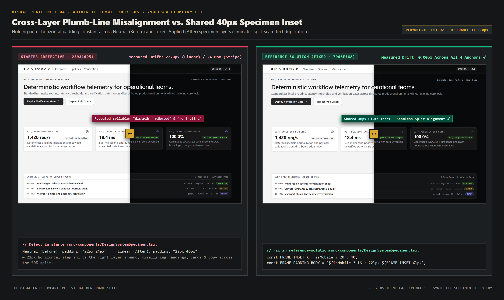
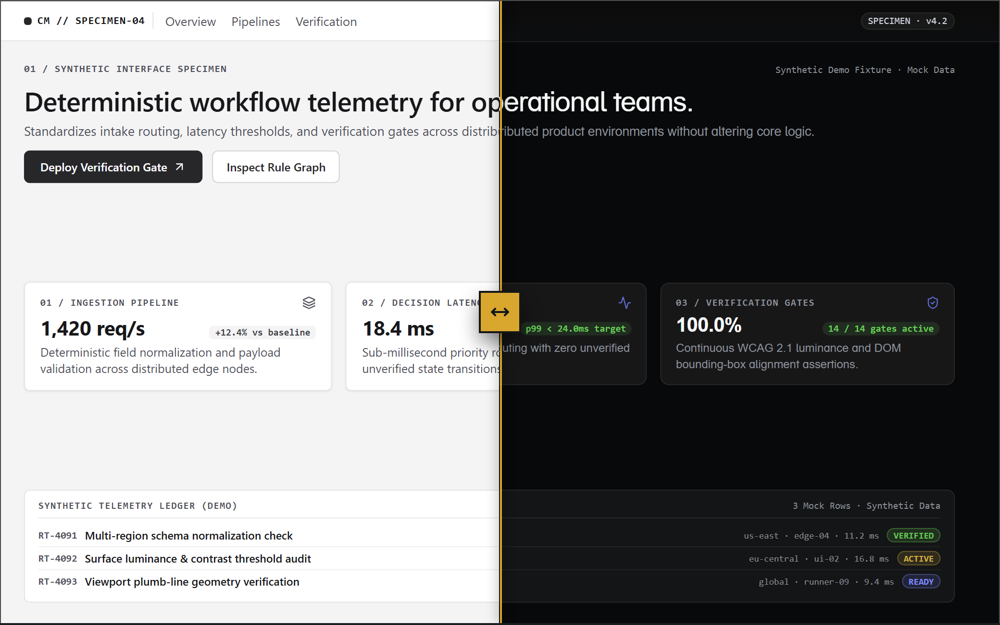
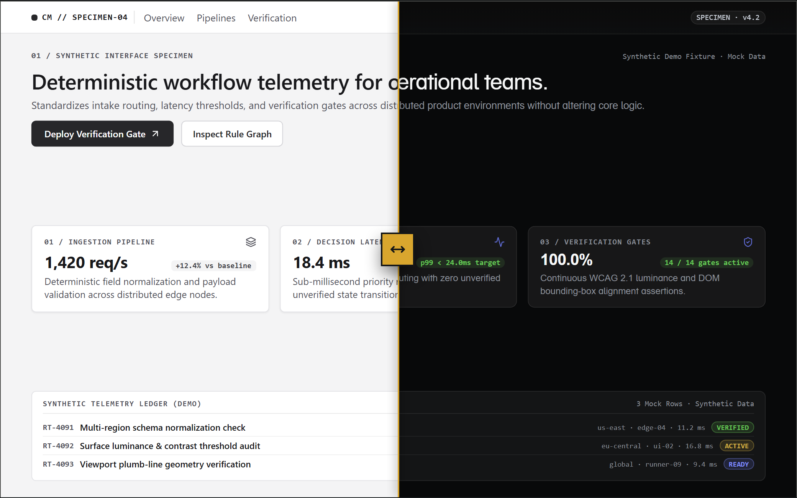
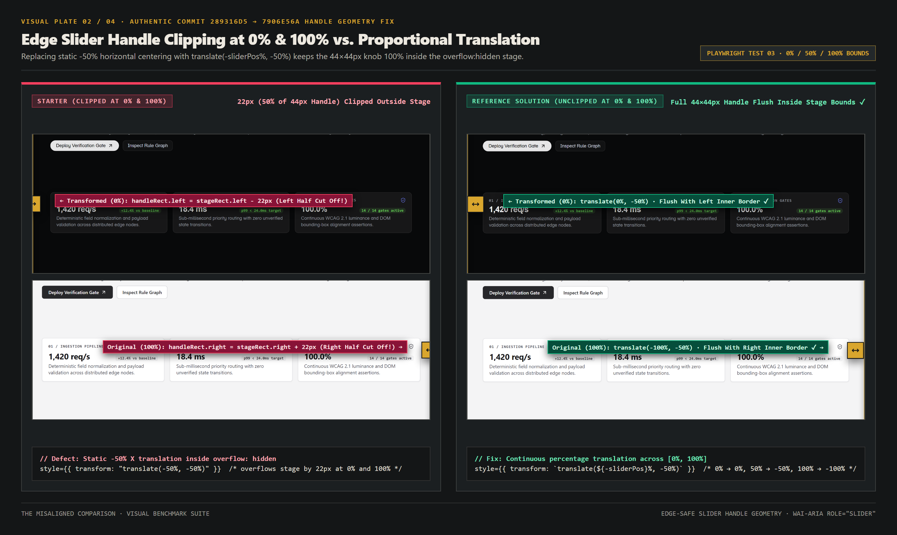
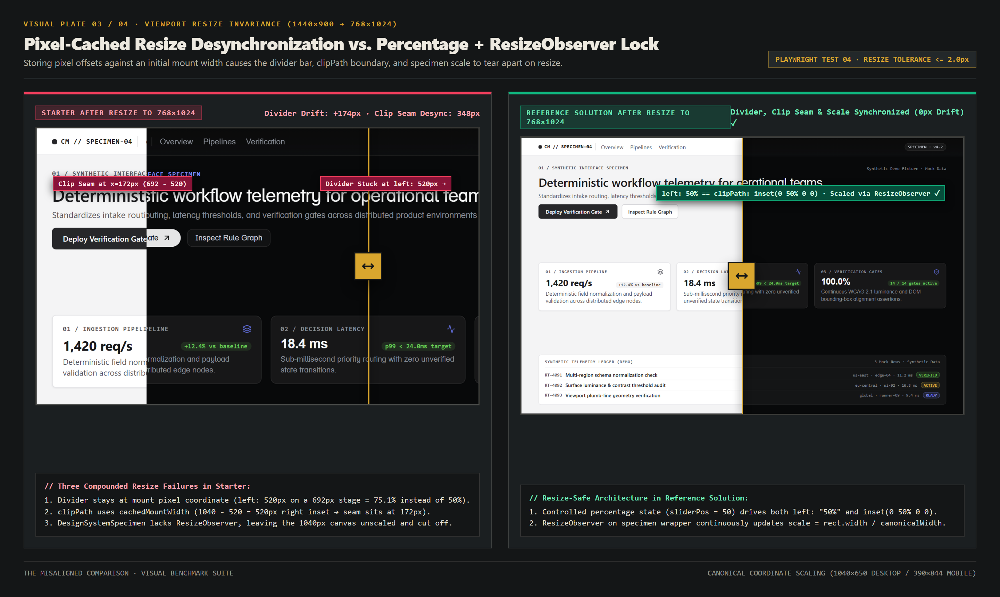
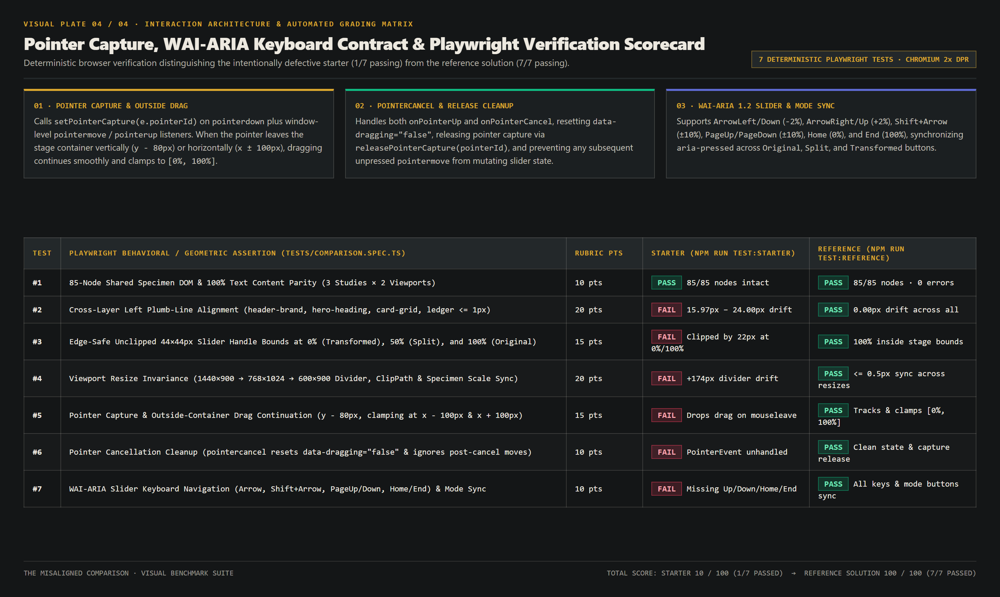
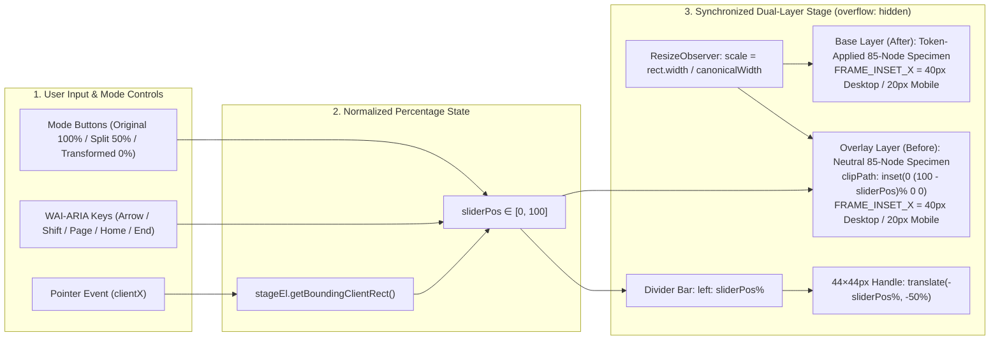

# Visual Comparison Debugging Challenge: The Misaligned Comparison

**Repair an Interactive Before/After Design-System Specimen Slider (React 19 + TypeScript + Vite + Playwright)**



---

## 1. Executive Summary & Historical Provenance

**The Misaligned Comparison** is a self-contained, production-grounded frontend engineering benchmark and hiring evaluation task derived from the **ContextMuse Design Intelligence** multi-system token comparator ([`rouguemuse/contextmuse`](https://github.com/rouguemuse/contextmuse)).

In the original study, an interactive dual-layer comparison stage evaluates how three contrasting design-system token profiles (**Study 01: Plaidis / Editorial Grid**, **Study 02: Linear / Stepped Obsidian Surfaces**, and **Study 03: Stripe / High-Key Daylight Hierarchy**) transform an identical **85-node neutral interface specimen** (`DesignSystemSpecimen`) without altering markup or copy.

### Source Commits & Authentic Defect History

- **[`289316d577f4b73383ff36529cc0f69622eeb4ac`](https://github.com/rouguemuse/contextmuse/commit/289316d577f4b73383ff36529cc0f69622eeb4ac)** (*feat(design-intelligence): add Original/Split/Transformed mode, Class D adaptation taxonomy, and synthetic specimen labels* — `2026-11-09`):
  - Introduced the `Original` (`100%` Before), `Split` (`50%` Before / `50%` After), and `Transformed` (`0%` Before / `100%` After) comparison mode buttons driving the continuous `clipPath: inset(0 ${100 - sliderPos}% 0 0)` overlay engine, alongside explicit synthetic fixture disclosures (`1,420 req/s`, `18.4 ms`, `100.0%`, `RT-4091..4093`, `85 / 85 identical nodes`).
  - Exhibited **two authentic geometric defects** captured in the historical specimen screenshots ([`references/authentic-source-evidence/`](./references/authentic-source-evidence/)):
    1. **Cross-Layer Plumb-Line Misalignment:** `DesignSystemSpecimen` applied per-variant outer horizontal padding (`Neutral: 24px` vs. `Plaidis: 40px`, `Linear: 46px`, `Stripe: 48px` on desktop; `12px–16px` vs. `20px–24px` on mobile). Because the stacked `Before` and `After` specimen layers did not share a common horizontal inset, headings, cards, and copy shifted horizontally across the split divider and repeated words across the seam (`"...across distrib|ributed product environments..."`).
    2. **Edge Slider Handle Clipping at `0%` and `100%`:** The `44×44px` slider knob (`role="slider"`) inside the `overflow: hidden` stage used static `-translate-x-1/2 -translate-y-1/2` centering (`translate(-50%, -50%)`), clipping `22px` (half the knob) outside the left stage border at `0%` (`Transformed`) and outside the right stage border at `100%` (`Original`).
- **[`7906e56ad4efd58987d182a83bf7e89029e328d5`](https://github.com/rouguemuse/contextmuse/commit/7906e56ad4efd58987d182a83bf7e89029e328d5)** (*fix(design-intelligence): align split comparison, unclip slider handle, re-shoot Linear reference* — `2026-11-11`):
  - Unified all four specimen variants onto a single controlled horizontal inset (`const FRAME_INSET_X = isMobile ? 20 : 40`), locking `Original`, `Split`, and `Transformed` onto one left plumb line (`0.00px` drift).
  - Replaced static `-50%` horizontal handle centering with dynamic percentage translation (`translate: `${-sliderPos}% -50%`` / `transform: translate(${-sliderPos}%, -50%)`), keeping the `44×44px` knob completely inside the stage frame across `[0%, 100%]`.

To form a comprehensive engineering evaluation that tests layout geometry, coordinate math, resize invariance, pointer capture, and accessibility together, [`starter/`](./starter/) combines those two authentic historical defects with two constructed slider interaction flaws: pixel-cached resize desynchronization and container-scoped mouse tracking that drops drag state on `mouseleave` without pointer capture or `pointercancel` cleanup. All imagery and telemetry in this repository are **100% synthetic demonstration fixtures**.

---

## 2. The Four Visual & Interactive Defects

### Defect 1 — Cross-Layer Horizontal Plumb-Line Misalignment (`24px` vs. `40px`/`46px`/`48px`)

In [`starter/src/components/DesignSystemSpecimen.tsx`](./starter/src/components/DesignSystemSpecimen.tsx), the `neutral` baseline layer uses `24px` desktop (`12px` header / `16px` body mobile) horizontal padding while `plaidis`, `linear`, and `stripe` apply `40px`, `46px`, and `48px` on desktop (`20px`, `24px`, `16px` body on mobile). At a `50%` split, the left plumb edges of the header brand mark, hero headline, 3-card metric grid, and telemetry ledger misalign by `16px–24px`, duplicating syllables across the divider.

| Defective Starter (`failing-starter-split-misaligned-desktop.png`) | Fixed Reference (`expected-split-50-desktop.png`) |
| :---: | :---: |
|  |  |

---

### Defect 2 — Clipped `44×44px` Slider Handle Near `0%` and `100%` Edges

In [`starter/src/components/BeforeAfterComparison.tsx`](./starter/src/components/BeforeAfterComparison.tsx), the `44×44px` handle (`[role="slider"]`) uses static `transform: translate(-50%, -50%)` inside the `overflow: hidden` stage. At `0%` (`Transformed`), `handleRect.left = stageRect.left - 22px`; at `100%` (`Original`), `handleRect.right = stageRect.right + 22px`, slicing half the handle off at either extreme.



---

### Defect 3 — Divider, Clip-Path & Specimen Scale Desynchronization During Resize

In [`starter/src/components/BeforeAfterComparison.tsx`](./starter/src/components/BeforeAfterComparison.tsx), the split position is stored in pixels (`dividerPx = 520`) against an initial container width cached only once on mount (`cachedMountWidth = 1040`), while [`starter/src/components/DesignSystemSpecimen.tsx`](./starter/src/components/DesignSystemSpecimen.tsx) computes its scale factor (`rect.width / canonicalWidth`) only once on mount without a `ResizeObserver`. When the viewport resizes from `1440×900` to `768×1024`, the divider remains stuck at `left: 520px` (`75.1%`), the `clipPath` right inset remains `520px` (placing the actual clip seam at `172px` — a `348px` gap from the divider bar), and the unscaled `1040px` specimen canvas overflows the narrowed container.



---

### Defect 4 — Lost Pointer Tracking Outside Container, Missing `pointercancel` Cleanup & Incomplete WAI-ARIA Keyboard Controls

In [`starter/src/components/BeforeAfterComparison.tsx`](./starter/src/components/BeforeAfterComparison.tsx):
- Dragging is bound via container-scoped `onMouseDown` / `onMouseMove` / `onMouseUp` with an `onMouseLeave` handler that terminates the drag (`isDragging = false`) the instant the pointer leaves the stage bounding box.
- `PointerEvent('pointercancel')` is unhandled, leaving drag state stuck if a gesture is interrupted.
- Keyboard navigation on `[role="slider"]` only handles `ArrowLeft` and `ArrowRight` in raw `20px` jumps and lacks `ArrowUp`, `ArrowDown`, `Shift+Arrow` (`±10%`), `PageUp`/`PageDown` (`±10%`), `Home` (`0%`), `End` (`100%`), and `Original` / `Split` / `Transformed` `aria-pressed` button synchronization.



---

## 3. Candidate Challenge & Constraints

Full candidate instructions and the 100-point rubric are documented in **[`task-spec.md`](./task-spec.md)**, with evaluator guidance and false-positive analysis in **[`grading-notes.md`](./grading-notes.md)**.

### Candidate Goal

Repair the defective implementation in [`starter/`](./starter/) so that all **7** automated Playwright verification tests in [`tests/comparison.spec.ts`](./tests/comparison.spec.ts) pass while preserving:
- **85-Node DOM & Text Parity:** `[data-specimen-variant]` must continue to render exactly `85` descendant DOM elements in identical tag sequence and with identical text content across `neutral`, `plaidis`, `linear`, and `stripe` in both `desktop` (`1040×650`) and `mobile` (`390×844`) viewports.
- **Stage Clipping Boundary:** Do not remove `overflow: hidden` from `[data-slider-stage="true"]`.
- **Zero External Slider Libraries:** Repair the React + TypeScript component directly using standard browser APIs (`PointerEvent`, `setPointerCapture`, `ResizeObserver`, WAI-ARIA slider semantics).

---

## 4. Reference Solution Architecture

The complete corrected implementation resides in **[`reference-solution/`](./reference-solution/)**:

1. **Shared Horizontal Plumb Inset ([`reference-solution/src/components/DesignSystemSpecimen.tsx`](./reference-solution/src/components/DesignSystemSpecimen.tsx)):**
   ```ts
   const FRAME_INSET_X = isMobile ? 20 : 40;
   const FRAME_PADDING_HEADER = `${isMobile ? 10 : 12}px ${FRAME_INSET_X}px`;
   const FRAME_PADDING_BODY = `${isMobile ? 16 : 22}px ${FRAME_INSET_X}px`;
   ```
   All four specimen variants (`neutral`, `plaidis`, `linear`, `stripe`) share the exact same horizontal outer padding (`40px` desktop, `20px` mobile), eliminating cross-divider horizontal jump (`0.00px` drift).
2. **Continuous `ResizeObserver` Canonical Frame Scaling ([`reference-solution/src/components/DesignSystemSpecimen.tsx`](./reference-solution/src/components/DesignSystemSpecimen.tsx)):**
   Observes the specimen wrapper with `ResizeObserver` (plus a `window` `resize` fallback) and updates `scale = rect.width / canonicalWidth` (`1040` desktop, `390` mobile) whenever the container or viewport changes size.
3. **Controlled Percentage State & Edge-Safe Handle Translation ([`reference-solution/src/components/BeforeAfterComparison.tsx`](./reference-solution/src/components/BeforeAfterComparison.tsx)):**
   - Stores `sliderPos` $\in [0, 100]$ (`100` = `Original`, `50` = `Split`, `0` = `Transformed`).
   - Drives both `[data-layer="before"]` (`clipPath: inset(0 ${100 - sliderPos}% 0 0)`) and `[data-slider-divider="true"]` (`left: ${sliderPos}%`) from `sliderPos`.
   - Translates the `44×44px` `[role="slider"]` handle via `transform: translate(${-sliderPos}%, -50%)`, smoothly interpolating from `(0%, -50%)` at `0%` to `(-50%, -50%)` at `50%` and `(-100%, -50%)` at `100%`.
4. **Pointer Capture, Outside-Container Clamping & Cancellation Cleanup ([`reference-solution/src/components/BeforeAfterComparison.tsx`](./reference-solution/src/components/BeforeAfterComparison.tsx)):**
   - Uses `onPointerDown`, `onPointerMove`, `onPointerUp`, and `onPointerCancel` with `setPointerCapture(e.pointerId)` plus window-level `pointermove` / `pointerup` / `pointercancel` listeners while dragging.
   - Maps `clientX` dynamically via `((clientX - rect.left) / rect.width) * 100` clamped to `[0, 100]`, continuing smoothly when the pointer leaves the container and cleaning up `data-dragging="false"` on outside release or `pointercancel`.



---

## 5. Objective Verification & Automated Grading Results

Complete execution logs are recorded in **[`verification-report.md`](./verification-report.md)**.

| Test # | Playwright Verification Gate ([`tests/comparison.spec.ts`](./tests/comparison.spec.ts)) | Points | `starter/` (`npm run test:starter`) | `reference-solution/` (`npm run test:reference`) |
| :---: | :--- | :---: | :---: | :---: |
| **1** | `[Parity & Setup]` 85-node shared specimen DOM & 100% text parity across all studies & viewports | 10 | **PASS** (`85/85` nodes) | **PASS** (`85/85` nodes, `0` errors) |
| **2** | `[Alignment Tolerance]` Before vs. After left plumb-line alignment (`<= 1px` across 4 anchors × 3 studies × 2 viewports) | 20 | **FAIL** (`15.97px–24.00px` drift) | **PASS** (`0.00px` drift) |
| **3** | `[Min/Max Positions & Handle Unclipped]` `44×44px` handle stays 100% inside stage bounds at `0%`, `50%`, and `100%` | 15 | **FAIL** (`22px` clipped at `0%`/`100%`) | **PASS** (`100%` inside bounds) |
| **4** | `[Resizing & Scale Sync]` Viewport resize (`1440×900 → 768×1024 → 600×900`) preserves divider, `clipPath`, and specimen scale | 20 | **FAIL** (`+174px` divider drift) | **PASS** (`<= 0.5px` sync) |
| **5** | `[Pointer Capture & Outside-Container Drag]` Dragging outside stage bounds tracks continuously and clamps to `[0%, 100%]` | 15 | **FAIL** (drops drag on `mouseleave`) | **PASS** (tracks & clamps `[0, 100]`) |
| **6** | `[Pointer Cancellation Cleanup]` `pointercancel` resets `data-dragging="false"` and ignores post-cancel pointer movement | 10 | **FAIL** (`PointerEvent` unhandled) | **PASS** (clean state & capture release) |
| **7** | `[Keyboard Accessibility & Mode Sync]` WAI-ARIA keys (`Arrow`, `Shift+Arrow`, `PageUp/Down`, `Home/End`) & mode button sync | 10 | **FAIL** (missing `Up/Down/Home/End`) | **PASS** (all keys & buttons sync) |
| **Total** | **7 Deterministic Chromium Verification Gates (`1440×900` @ `2x DPR`)** | **100** | **10 / 100 (`1 passed, 6 failed`)** | **100 / 100 (`7 passed, 0 failed`)** |

---

## 6. Repository Structure

```text
visual-comparison-debugging-challenge/
├── README.md                  # Portfolio overview, 4 visual defects, architecture & verification matrix
├── task-spec.md               # Candidate-facing prompt, allowed modifications & 100-point rubric
├── grading-notes.md           # Evaluator guide, objective vs. subjective criteria & false-positive analysis
├── verification-report.md     # Executed install, typecheck, lint, build & Playwright test logs
├── package.json               # Root scripts for dev, build, lint, typecheck, and Playwright suites
├── playwright.config.ts       # Deterministic Chromium configuration (1440×900 @ 2x DPR)
├── vite.config.ts             # Targets `starter` (default) or `reference-solution` via CHALLENGE_TARGET
├── tsconfig.json              # Strict TypeScript configuration
├── eslint.config.js           # ESLint 9 + TypeScript + React Hooks configuration
├── references/                # Visual evidence, interactive simulator & interaction documentation
│   ├── interaction-notes.md   # Deep dive into authentic commit history vs. challenge fixtures
│   ├── visual_walkthrough.md  # Visual dossier with 4 annotated plates & Mermaid diagrams
│   ├── comparison_defect_explorer.html # Standalone interactive HTML simulator (Starter vs. Reference)
│   ├── visual-plates/         # 4 high-resolution (2880×1720) annotated comparison plates
│   ├── authentic-source-evidence/ # Historical synthetic specimen captures from commit 289316d5
│   ├── expected-*.png         # Unannotated stage captures from reference-solution/
│   └── failing-starter-*.png  # Unannotated stage captures from starter/
├── starter/                   # Intentionally defective React + TypeScript + Vite implementation
│   └── src/
│       ├── components/
│       │   ├── BeforeAfterComparison.tsx
│       │   ├── DesignSystemSpecimen.tsx
│       │   └── SyntheticPlateSurface.tsx
│       └── data/studies.ts
├── reference-solution/        # Complete corrected React + TypeScript + Vite implementation
│   └── src/
│       ├── components/
│       │   ├── BeforeAfterComparison.tsx
│       │   ├── DesignSystemSpecimen.tsx
│       │   └── SyntheticPlateSurface.tsx
│       └── data/studies.ts
├── scripts/
│   ├── capture-references.mjs # Automated Playwright capture of expected-*.png & failing-starter-*.png
│   └── generate-visual-plates.mjs # Automated Playwright generator for references/visual-plates/*.png
└── tests/
    └── comparison.spec.ts     # 7 deterministic Playwright behavioral & geometric tests
```

---

## 7. Quick Start & Commands

```bash
# 1. Install dependencies and Playwright Chromium
npm install
npx playwright install chromium

# 2. Run the defective starter app (http://127.0.0.1:5173)
npm run dev:starter

# 3. Run the corrected reference solution
npm run dev:reference

# 4. Run TypeScript typechecking, ESLint, and production builds
npm run typecheck
npm run lint
npm run build

# 5. Execute the Playwright verification suite against starter (1 passed, 6 failed)
npm run test:starter

# 6. Execute the Playwright verification suite against reference-solution (7 passed, 0 failed)
npm run test:reference
```
