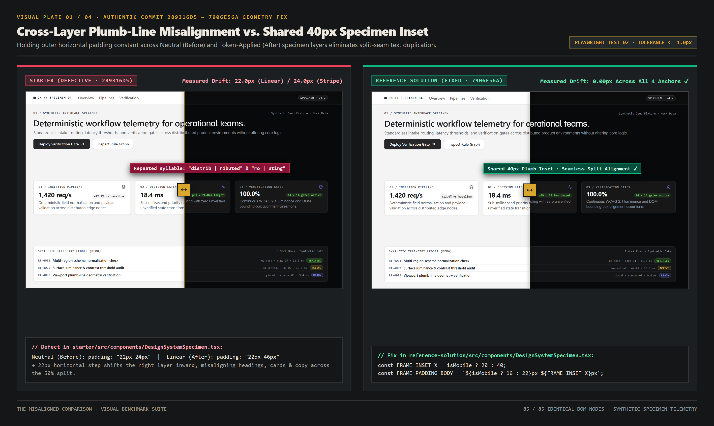
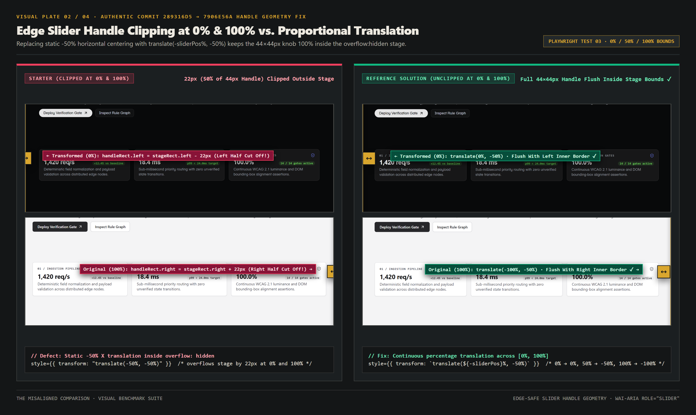
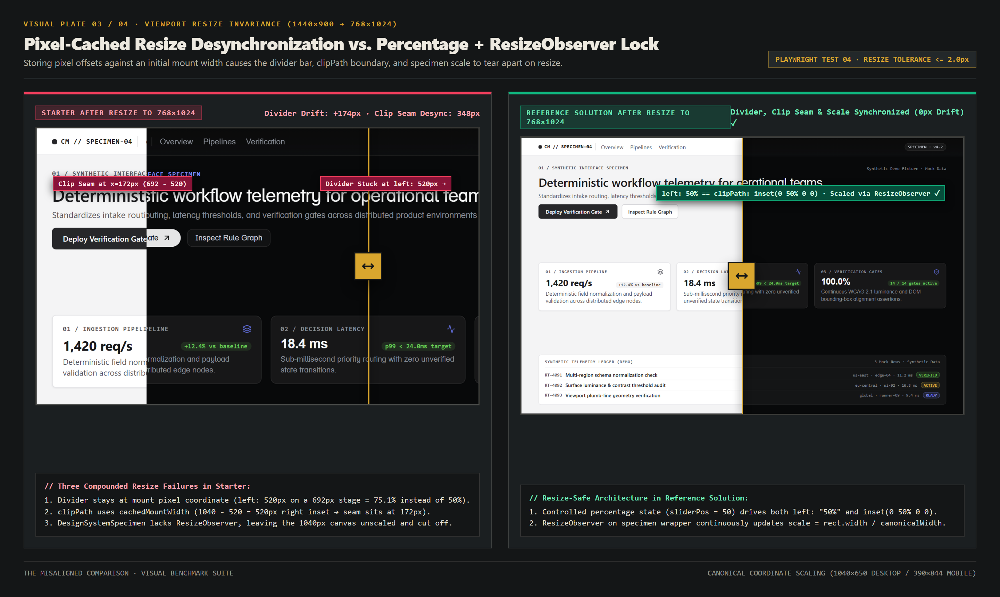
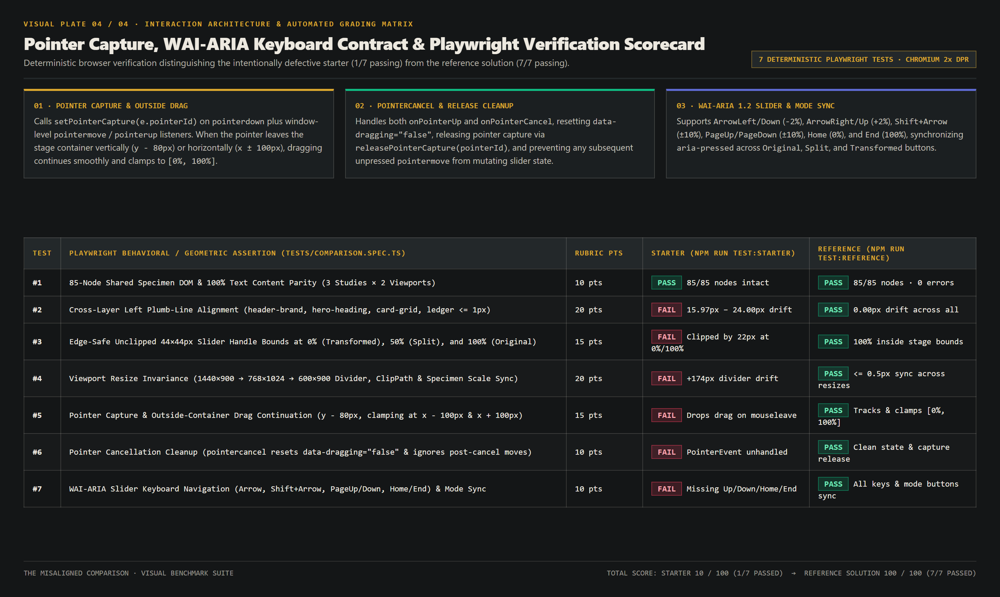
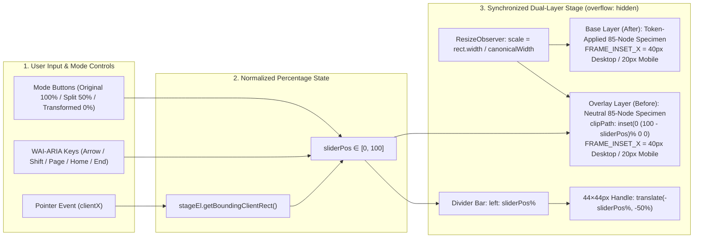
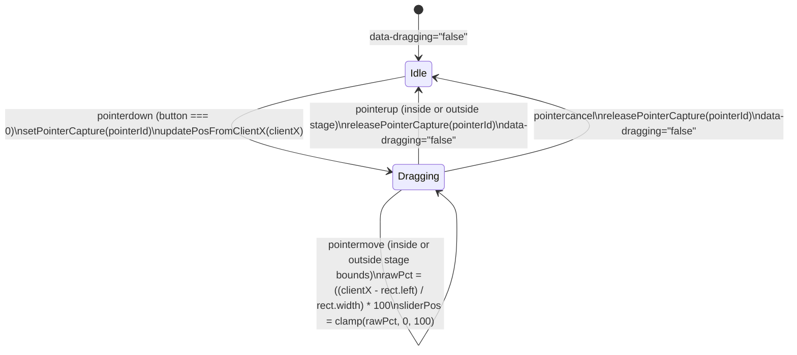

# Visual Walkthrough: The Misaligned Comparison

This visual dossier presents the four annotated comparison plates and architectural diagrams for **The Misaligned Comparison: Repair an Interactive Before/After Slider**.

---

## 1. Four Annotated Visual Comparison Plates (Starter vs. Reference Solution)

### Plate 01 — Cross-Layer Plumb-Line Misalignment vs. Shared 40px Specimen Inset (`289316d5` → `7906e56a`)

### Plate 02 — Edge Slider Handle Clipping at `0%` & `100%` vs. Proportional Translation (`289316d5` → `7906e56a`)

### Plate 03 — Pixel-Cached Resize Desynchronization (`1440×900` → `768×1024`) vs. Percentage + `ResizeObserver` Lock

### Plate 04 — Pointer Capture, WAI-ARIA Keyboard Contract & Playwright Verification Scorecard

---

## 2. Dual-Layer Coordinate & Resize Pipeline

---

## 3. Pointer Capture & Cancellation State Machine

---

## 4. Interactive HTML Simulator

Open [`comparison_defect_explorer.html`](./comparison_defect_explorer.html) in any browser to interactively toggle between the defective **Starter** and the fixed **Reference Solution**, test `Original (100%)` / `Split (50%)` / `Transformed (0%)` handle bounds, and simulate live container resizing (`100%` down to `60%`).
